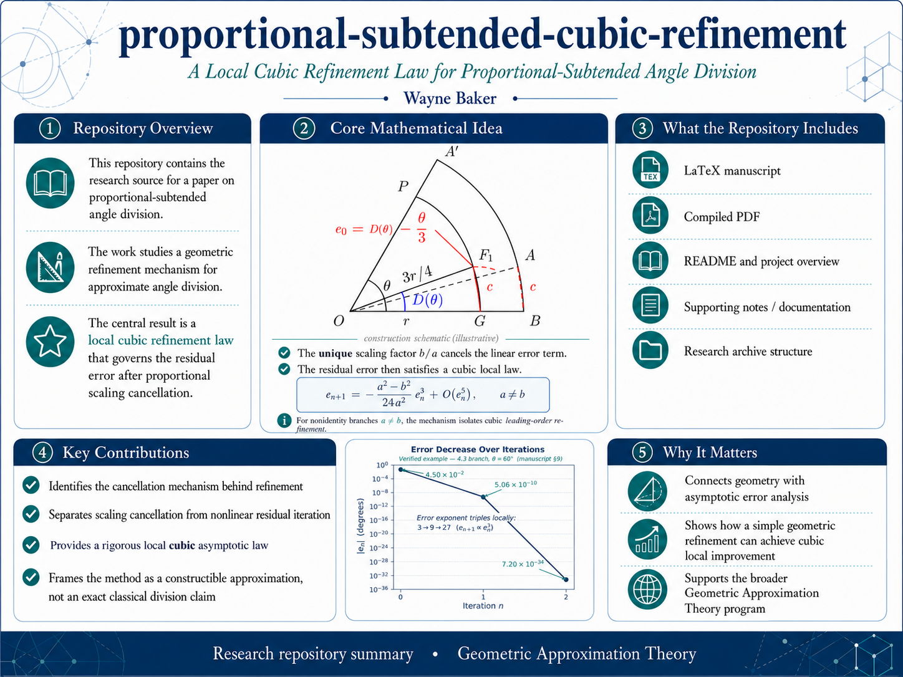

<p align="center">
  
</p>

# A Local Cubic Refinement Law for Proportional-Subtended Angle Division

**Author:** Wayne Baker  
**Date:** July 2, 2026  
**Status:** Preprint / source archive

This repository contains the LaTeX source and compiled PDF for:

> **A Local Cubic Refinement Law for Proportional-Subtended Angle Division**

## Read the paper

- [Read the paper (PDF)](Paper/local_cubic_refinement_proportional_subtended.pdf)
- [LaTeX source](Paper/local_cubic_refinement_proportional_subtended.tex)
- [Latest release](https://github.com/CWBaker360/proportional-subtended-cubic-refinement/releases/latest)

## Main result

For positive integers $a$ and $b$, define the proportional-subtended seed operator

$$
D_{a,b}(\theta)
=
2\arcsin\!\left(
\frac{a}{b}\sin\frac{\theta}{2a}
\right).
$$

On the local principal branch,

$$
D_{a,b}(\theta)-\frac{\theta}{b}
=
\frac{a^2-b^2}{24a^2b^3}\theta^3
+
O(\theta^5).
$$

For a signed error $e$, define

$$
\Phi_{a,b}(x)
=
2\arcsin\!\left(
\frac{a}{b}\sin\frac{x}{2}
\right),
$$

and

$$
\mathcal R_{a,b}(e)
=
e-\Phi_{a,b}\!\left(\frac{b}{a}e\right).
$$

For every nonidentity branch $a\ne b$,

$$
\mathcal R_{a,b}(e)
=
-\frac{a^2-b^2}{24a^2}e^3
+
O(e^5).
$$

The scale factor $b/a$ is the unique constant scaling that cancels the
linear term in the one-transfer correction class. Repeated residual
correction therefore produces the local order sequence

$$
3,\;9,\;27,\;81,\ldots
$$

## Lean 4 formal verification (November 20, 2026)

The reproducible [Lean source release](lean/) verifies the **leading cubic-limit coefficient** of the proportional-chord residual:

$$
\lim_{\theta\to 0}
\frac{D_{a,b}(\theta)-\theta/b}{\theta^3}
= \frac{a^2-b^2}{24a^2b^3},
\qquad a,b\in\mathbb R\setminus\{0\}.
$$

This includes Baker's \(4{:}3\) coefficient \(7/10368\) and the equal-parameter case. The Lean theorem applies to nonzero **real** parameters, broader than the positive integers in the manuscript.

**Formal-verification scope:** This release proves the cubic *limit*. It does **not** formalize the \(O(\theta^5)\) remainder, the nonlinear residual \(\mathcal R_{a,b}(e)\) law, uniqueness of the \(b/a\) scaling, or the iterated \(3,9,27,\ldots\) order sequence.

See [Lean reproducibility instructions](lean/README-REPRODUCE.txt). The proof chain completed a fresh Windows build (18,270 Lake jobs) and a separate definition audit (exit code 0) on November 20, 2026. GitHub Actions independently checks the Linux build and axiom reports.

## Scope

The theorem is local and asymptotic. It is not a global angle-division theorem.

A direct finite straightedge-and-compass realization is proved for the
repeated-bisection subclass $a=2^m$. The paper also gives a two-sample chord
calculation whose residual begins at fifth order.

## Historical note

The motivating $4{:}3$ branch is Wayne Baker's approximate-trisection
construction. Rouben Rostamian analyzed that special case, including its
cubic seed error and the ninth-order error produced by one residual
improvement.

The present paper develops the general $(a,b)$ law and the associated
uniqueness and sharpness results.

## Research triad

This paper is the second work in a three-paper research sequence:

1. [A Constructible Cubic Error Cascade for Approximate Angle Trisection](https://github.com/CWBaker360/Constructible-Cubic-Trisection/releases/latest)
2. [A Local Cubic Refinement Law for Proportional-Subtended Angle Division](https://github.com/CWBaker360/proportional-subtended-cubic-refinement/releases/latest)
3. [A Constructive N-Series Acceleration Law for Polygonal Approximation of π](https://github.com/CWBaker360/N-Series-pi-acceleration/releases/latest)

Together, the three papers develop the progression

**constructible approximation → local cubic refinement → higher-order acceleration**.

The first paper presents a specific constructible approximation and its cubic
error cascade. The second derives the general proportional-subtended
cancellation law and proves the uniqueness of the scaling that removes the
linear residual term. The third applies structured asymptotic cancellation to
accelerate polygonal approximations of π.
## Repository structure

```text
.
├── README.md
├── CITATION.cff
├── REPRODUCIBILITY.md
├── LICENSE
├── LICENSE-PAPER.md
├── LICENSE_NOTICE.md
├── CHANGELOG.md
├── SHA256SUMS.txt
├── .gitignore
├── lean/                   # Lean 4 verified source release
├── assets/
│   └── Repo02_proportional-subtended-cubic-refinement.png
├── Paper/
│   ├── local_cubic_refinement_proportional_subtended.tex
│   ├── local_cubic_refinement_proportional_subtended.pdf
│   └── README.md
└── docs/
    ├── abstract.md
    ├── repository_description.md
    ├── github_upload_checklist.md
    └── first_repository_readme_patch.md

```
## Licensing

This repository uses a dual-license structure:

- The manuscript text, LaTeX manuscript source, compiled PDF, figures,
  documentation, and supporting written research materials are licensed under
  the **Creative Commons Attribution 4.0 International License (CC BY 4.0)**.
  See [`LICENSE-PAPER.md`](LICENSE-PAPER.md).

- Executable source code, scripts, and software utilities are licensed under
  the **MIT License**. See [`LICENSE`](LICENSE).

The LaTeX manuscript source is treated as research and publication material
and is therefore licensed under CC BY 4.0.

For the detailed scope of each license, see
[`LICENSE_NOTICE.md`](LICENSE_NOTICE.md).

Copyright © 2026 Wayne Baker.
